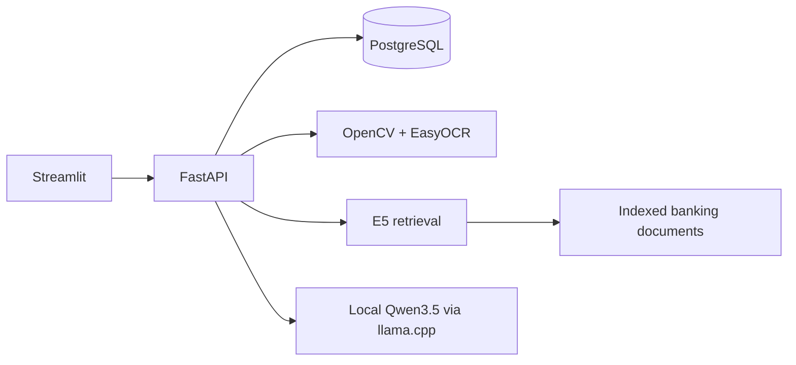

# BankWise

**An Arabic-first banking demo with local AI assistance and Egyptian National ID OCR.**

BankWise combines a FastAPI backend, a Streamlit interface, PostgreSQL, document-based retrieval, and locally hosted language and OCR models. It is an educational banking simulation: balances and transactions are demo data, not connections to a live bank.

[Getting started بالعربي](docs/team_setup.md) · [Model weights](https://github.com/Hamoshady/BankWise/releases/tag/models-20261122-v1) · [API contract](docs/api_contract.md)

## What you can do

- Sign in with a username, password, and a single-use OTP. The shared development setup displays the OTP locally; it does not send a real SMS.
- Apply for an account using front/back National ID images, OCR-assisted data entry, and KYC review.
- Review applications and approve accounts. Newly approved accounts start at zero; authorized demo deposits are recorded as transactions.
- Transfer between 12-digit account numbers and view balances, transaction references, receipts, and statements.
- Ask an Arabic banking assistant questions backed by the project's document collection.
- Run OCR experiments without changing the default production/development recognition backend.

## Architecture



EasyOCR remains the default. PaddleOCR, YOLO11n field/digit detectors, and CRNN-CTC are experimental components whose weights are included for reproducibility, but are not enabled by the normal launcher.

## Quick start

### Prerequisites

- An Intel/AMD x86-64 machine.
- Docker Desktop using **Linux containers / WSL2** on Windows, or Docker Engine with Compose on Linux.
- Python **3.11 or newer**, Git, and GitHub CLI (`gh`).
- Internet access for the initial download and Docker build.
- Around **20 GB free disk space**. **24 GB RAM is preferred**; 16 GB may work with other applications closed, but 8/16 GB memory limits have not been benchmarked. No NVIDIA GPU is required.

Official installers: [Docker Desktop](https://www.docker.com/products/docker-desktop/) · [Python](https://www.python.org/downloads/windows/) · [Git](https://git-scm.com/install/windows) · [GitHub CLI](https://cli.github.com/).

With Docker running, open PowerShell or a terminal:

```sh
gh auth login
gh repo clone Hamoshady/BankWise -- --branch main --single-branch
cd BankWise
python scripts/team.py start
```

On Linux, use `python3` if `python` is unavailable. Wait for **`BankWise ready`**, then open **http://127.0.0.1:8501/**.

The launcher downloads the model release, verifies SHA-256 hashes, rebuilds the services from source, and restores the included database snapshot into a separate Docker volume on first startup. Initial downloads include about **3.86 GB of model files**, plus Docker/Python dependencies. Source ZIP downloads alone do not contain the large weights.

For a different port:

```sh
python scripts/team.py start --port 8502
```

### Stop, restart, and diagnose

Run these commands from the `BankWise` folder:

```sh
python scripts/team.py stop
python scripts/team.py start
python scripts/team.py status
python scripts/team.py logs
```

Each installation has its own database. Stopping the services preserves balances and transactions. Do not delete `.team.env` or Docker volumes if you want to retain that installation's data.

### Login and account approval

The snapshot retains existing accounts and password hashes. Obtain known login credentials from the project owner; passwords cannot be recovered from the hashes. A new signup request requires approval by an existing authorized reviewer. The reviewer account's stored plaintext credential was not confirmed against the snapshot; do not assume a default admin password exists.

## Included models

| Component | Model | Default |
|---|---|---|
| Assistant | Qwen3.5-4B, Q4_K_M GGUF | Yes |
| Retrieval | multilingual-e5-small | Yes |
| OCR | EasyOCR Arabic/English + CRAFT | Yes |
| Alternative OCR | Arabic PP-OCRv5 mobile recognition | No |
| Field localization | Trained YOLO11n field detector | No |
| Numeric OCR | YOLO11n digits and lightweight CRNN-CTC | No |

Weights are published under [Releases](https://github.com/Hamoshady/BankWise/releases). Qwen is split into release-sized parts and automatically reassembled. The package excludes unused historical Qwen2.5 weights and intermediate training checkpoints. Model origins, exact hashes, and license labels are in [the model manifest](configs/team_models.json); license notices are in [model-seed/licenses](distribution/team/model-seed/licenses).

## Repository guide

| Path | Purpose |
|---|---|
| `src/bankwise/` | API, authentication, banking demo, persistence, assistant, and retrieval |
| `src/id_ocr/` | OCR localization, preprocessing, recognition, validation, and experiments |
| `ui/` | Streamlit application |
| `scripts/team.py` | Docker launcher for a source checkout |
| `scripts/team_models.py` | Verified model download, packaging, and installation |
| `shared_snapshot/` | Database dump, runtime outputs/configuration, and supplied card examples |
| `test_data/` | Supplied OCR examples and reference data |
| `tests/` | Unit, integration, UI, and packaging checks |
| `evaluation/` | Benchmark protocols and recorded results |
| `docs/` | Setup, API, architecture, experiments, and limitations |

The shared snapshot includes real identity examples and runtime configuration at the owner's request. It is a local demo distribution, not a hardened public banking deployment. OCR formatting checks are not proof of document authenticity; OCR and model accuracy are not guaranteed across all cards.

## Documentation and verification

- [Arabic team setup](docs/team_setup.md)
- [Signup and review](docs/customer_onboarding.md)
- [Login OTP](docs/two_factor_login.md)
- [Account numbers](docs/account_numbers.md) and [transaction references](docs/transaction_references.md)
- [OCR backends](docs/ocr_backends.md) and [numeric OCR experiments](evaluation/numeric_ocr/README.md)
- [Local Qwen](docs/local_llm.md) and [semantic retrieval](docs/semantic_rag.md)
- [Backend development and tests](docs/backend_setup.md)
- [Previous development README](docs/README_previous.md)

The preceding shared version passed Linux/Docker startup checks, database snapshot comparisons, model checksum verification, seven synthetic model-packaging tests, and a clean GitHub Actions Docker build. Windows has not been directly tested. See this repository's [Actions](https://github.com/Hamoshady/BankWise/actions) for results after publication; earlier results are not a claim that a new run has completed.

## Team

| Member | GitHub |
|---|---|
| Shady / repository owner | [@Hamoshady](https://github.com/Hamoshady) |
| Soliman | [@solimanmohamed7177-arch](https://github.com/solimanmohamed7177-arch) |
| Mohamed Nasser | [@mohamed-nasser170](https://github.com/mohamed-nasser170) |
| Mazen Samir | [@Mazen-samir1](https://github.com/Mazen-samir1) |
| Aya | [@aya205-elghon](https://github.com/aya205-elghon) |

Collaborator invitations are managed separately from this credits list; listing a member here does not itself grant repository access.
