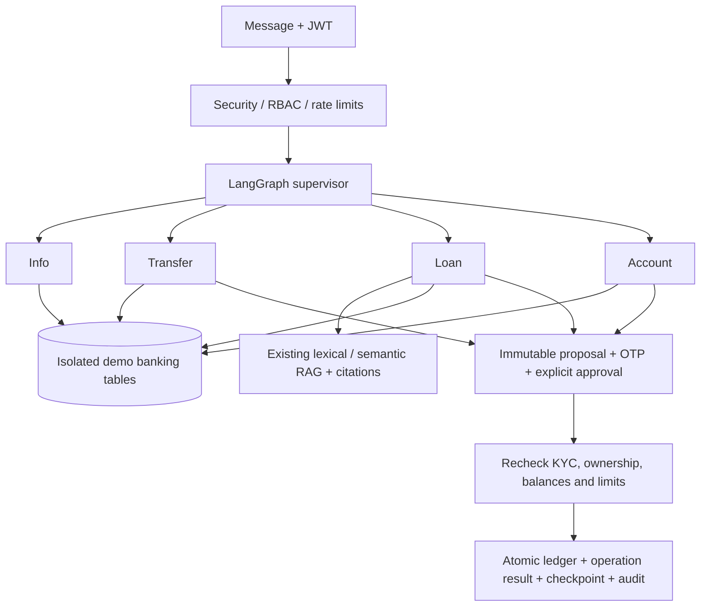

# المساعد البنكي: Supervisor + Specialist agents

المسار الجديد: `POST /api/v1/assistant/chat`. العميل التفاعلي:
`python3 scripts/ask_assistant_api.py`.
مسار `/api/v1/rag/query` وعميل `ask_rag.py` القديم يفضلوا للاسترجاع فقط؛
استخدم العميل الجديد للوكلاء والعمليات البنكية.

## الهيكل



Implemented with LangGraph `StateGraph` and conditional routing. Natural-language requests
use the existing local Qwen LLM to select a validated tool plan (up to three tools,
at most one sensitive proposal). Explicit service forms dispatch a typed tool directly.
Unavailable or invalid model output fails explicitly; there is no rule-routing fallback.
Retrieval output is evidence only: it cannot confirm operations.
The model never supplies authorization, account ownership or approval decisions.

## تشغيل النسخة المحلية

الحسابات والأرصدة والتحويلات هنا تجريبية، بالجنيه المصري فقط. مفيش اتصال ببنك حقيقي.
الـOTP التجريبي بيتعرض من endpoint محمي بنفس JWT؛ ده لتجربة الـflow فقط، مش عامل تحقق مستقل.
الـKYC التجريبي بيتحدد وقت تجهيز المستخدم، ومش قرار اعتماد من OCR أو بنك.

1. ثبّت dependencies المحدثة داخل بيئة المشروع أو أعد بناء الصورة.
2. أوقف API، وطبّق `alembic upgrade head`؛ المهاجرة الجديدة `0005_assistant`.
3. فعّل `BANKWISE_BANKING_MODE=demo` في ملف البيئة المستخدم فعليًا للتشغيل.
4. جهّز مستخدمين بدور `customer` ثم حسابات Demo. مفيش كلمات مرور افتراضية.

لإعداد Docker المحلي الموجود في المشروع:

```bash
# Add BANKWISE_BANKING_MODE=demo to ~/.config/bankwise_ai/local-api.env first.
python3 scripts/local_api.py stop
python3 scripts/local_api.py build
python3 scripts/local_api.py migrate
python3 scripts/local_api.py create-user --username demo_alice --roles customer
python3 scripts/local_api.py create-user --username demo_bob --roles customer
python3 scripts/local_api.py seed-demo --username demo_alice --balance 10000 --verified
python3 scripts/local_api.py seed-demo --username demo_bob --balance 1000 --verified
python3 scripts/local_api.py up
python3 scripts/ask_assistant_api.py
```

أوامر CLI المباشرة المقابلة، بعد ضبط متغيرات قاعدة البيانات والأمان:

```bash
python -m bankwise.database.cli create-user --username demo_alice --roles customer
python -m bankwise.database.cli seed-demo --username demo_alice --balance 10000 --verified
```

`seed-demo` يرفض تكرار تجهيز نفس المستخدم، ويسجل الرصيد الابتدائي كإيداع تجريبي.
بدون `--verified` يفضل KYC غير معتمد والعمليات/بيانات الحسابات مقفولة.
شغّل أوامر تجهيز المستخدمين والخدمات متوقفة، حسب سياسة كاتب الـaudit الواحد الموجودة في المشروع.
لم يتم تعديل قاعدة بيانات المستخدم الحالية أو تشغيل هذه الأوامر عليها تلقائيًا.

## API

كل المسارات تحتاج JWT بدور يمنح `assistant:use`؛ الدور الافتراضي الممنوح هو `customer`.
لا يقبل السيرفر `owner_id` أو KYC أو حالة موافقة من نص الرسالة.

| المسار | الوظيفة |
| --- | --- |
| `POST /api/v1/assistant/chat` | تشغيل الوكلاء أو استكمال بيانات ناقصة |
| `GET /api/v1/assistant/conversations/{id}` | قراءة checkpoint الخاص بالمستخدم |
| `POST /api/v1/assistant/operations/{id}/confirm` | OTP + موافقة صريحة أو إلغاء |
| `GET /api/v1/assistant/demo/otp/{id}` | inbox تجريبي، متاح في demo فقط |
| `GET /api/v1/assistant/statement.pdf` | كشف حساب PDF محمي؛ يقبل `account_id` اختياري |

مثال طلب تحويل؛ استخدم معرّفات الحسابات الناتجة من `seed-demo`:

```json
{
  "message": "حوّل 100 جنيه",
  "tool": "execute_transfer",
  "arguments": {
    "account_id": "SOURCE_ACCOUNT_UUID",
    "beneficiary_id": "DESTINATION_ACCOUNT_UUID",
    "amount": "100.00"
  }
}
```

النتيجة `awaiting_confirmation` فيها `operation.id` وملخص ثابت للبيانات ووقت الانتهاء.
اعرض الملخص للمستخدم، واقرأ كود الـDemo من مسار inbox، ثم أرسل لنفس العملية:

```json
{"approved": true, "otp": "123456"}
```

لإلغاء العملية: `{"approved": false}`. الكود ينتهي بعد 5 دقائق؛ 5 أخطاء توقف العملية.
الرد `invalid_otp` ييجي HTTP 200 عشان عدّاد المحاولات يتحفظ؛ لازم العميل يفحص `status`.
إعادة إرسال التأكيد لنفس العملية المكتملة ترجع نفس النتيجة من غير خصم جديد.
لا تعِد إنشاء عملية جديدة لمجرد إن رد التأكيد ضاع.
أي تعديل على مبلغ/مستفيد عملية معلقة يحتاج إلغاءها وإنشاء اقتراح جديد.

طلبات تحتاج بيانات إضافية ترجع `needs_input` و`missing`. أرسل `conversation_id` نفسه
مع `arguments` الجديدة. يقدر يستوعب ردود رقمية بسيطة: `5000 جنيه لمدة 12 شهر` أو رقم
واحد لما يكون ناقص حقل رقمي واحد. معرفات الحسابات تُرسل في `arguments` بصيغة UUID.

في العميل التفاعلي:

```text
عايز كشف حساب وشروط القرض
/tool create_loan_request
5000 جنيه لمدة 12 شهر
/otp
/confirm 123456
```

الكود في المثال مجرد placeholder؛ استخدم الكود الفعلي. `/cancel` يلغي العملية،
و`/new` يبدأ محادثة جديدة. نتائج السياسات تتضمن citations من الـRAG الحالي.

## الأدوات والقواعد التجريبية

| الوكيل | الأدوات |
| --- | --- |
| Info | `get_statement`, `get_last_withdrawals`, `get_last_deposits`, `analyze_spending`, `export_statement_pdf` |
| Transfer | `execute_transfer` بعد التحقق من المستفيد والرصيد والحدود ثم OTP |
| Loan | `check_eligibility`, `calc_installments`, `search_knowledge_base`, `create_loan_request` بعد OTP |
| Account | `check_kyc_status`, `check_closing_conditions`, `open_account`, `close_account` بعد OTP |

- البيانات المالية تُقرأ من جداول Demo، والسياسات من RAG مع عزل الملكية الحالي.
- حد التحويل التجريبي اليومي 50,000 EGP لكل عميل، محسوب على يوم UTC.
- فتح حساب يبدأ برصيد صفر، وبحد أقصى 5 حسابات مفتوحة لكل عميل.
- إغلاق الحساب يتطلب رصيد صفر وعدم وجود طلب قرض قيد المراجعة.
- القرض ينشئ طلب `pending_review` فقط؛ لا يصرف أموالًا ولا يزعم موافقة ائتمانية.
- `calc_installments` يتطلب `amount`, `months`, `annual_rate`؛ تقدير reducing-balance
  بالسعر الذي يدخله المستخدم، بدون رسوم أو تأمين، وليس عرضًا من البنك.
- الكشوف والتحليل يعرضوا آخر 100 معاملة؛ `outgoing_total` مجموع التدفقات الخارجة في هذه العينة.
  التحويل بين حسابات المستخدم نفسه يظهر `internal` ولا يُحسب إنفاقًا خارجيًا.
- الـPDF يستخدم تنسيقًا إنجليزيًا ثابتًا وخطًا مضمنًا؛ لا يحتوي على نص مستخدم غير موثوق.

## الاستمرارية والأمان وحدود النسخة

الجداول `assistant_conversations` و`assistant_operations` تحفظ استكمال الطلب والعملية.
كمان `assistant_graph_checkpoints` و`assistant_graph_writes` بيحفظوا native LangGraph
checkpoints بعد كل خطوة باستخدام sync durability، في معاملات مستقلة تستمر لو خطوة لاحقة فشلت.
كل تشغيل له run_id مربوط بالمستخدم والمحادثة. لا توجد واجهة replay أو time travel لمسار مالي.
الحفظ يتضمن نتائج الأدوات والأدلة المسترجعة، لكنه يستبعد نص الرسالة الخام والتوكن وOTP.
ظهور checkpoint لا يثبت تنفيذ تحويل؛ نتيجة العملية وسجل المعاملة هما المرجع.
واجهة «سجل العمليات» تعرض الأحداث ومراحل المساعد، وتتيح القائمة الجانبية استكمال طلب سابق.
`GET /assistant/audit` و`GET /assistant/checkpoints` و`GET /assistant/recent-conversations`
تحت `/api/v1` تعيد سجلات المستخدم الحالي فقط.
OTP محفوظ كـArgon2 hash؛ inbox التجريبي فقط يحتفظ بالكود في ذاكرة process، بحد 1000 كود.
عند إعادة تشغيل السيرفر تفضل العمليات محفوظة لكن الأكواد تضيع؛ ألغِ الطلب المعلق ثم أعده.
استخدم worker واحد كما هو إعداد المشروع الحالي.

تأكيد العملية يقفل conversation وoperation وصفوف الحسابات، ويعيد فحص KYC والملكية
والرصيد والحدود. النتيجة والـledger والـcheckpoint وسجل `assistant_audit` يتثبتوا
في transaction واحدة. الـaudit الخارجي يسجل authorization/attempt؛ السجل داخل DB هو
دليل نتيجة transaction. سجلات DB ليست tamper-proof أمام مدير قاعدة البيانات.

لا توجد سياسة حذف تلقائية لحالات المساعد أو دفتر Demo بعد؛ يُحتفظ بها حتى صيانة DB.
الـsupervisor routing محدود بالمفردات المعروفة، وواجهة `tool` المكتوبة أوضح للطلبات المركبة.
طلب واحد يسمح بعملية حساسة واحدة، مع إمكانية تشغيل أدوات قراءة أخرى قبله.
النسخة دي لا تنفذ التحويلات الحقيقية أو توصيل SMS أو اعتماد KYC حقيقي.

## التحقق

```bash
python -m pytest tests/unit/test_assistant.py -q
BANKWISE_TEST_POSTGRES=1 python -m pytest tests/integration/backend/test_assistant_api.py tests/integration/backend/test_database_schema.py -q
```

اختبارات PostgreSQL تنشئ حاوية مؤقتة مستقلة؛ لا تأخذ URL قاعدة بياناتك الحالية.
مرجع تنفيذ الرسم: [LangGraph Graph API](https://docs.langchain.com/oss/python/langgraph/graph-api).

### الموديل المحلي الحالي وحدوده
النسخة المحلية تستخدم Qwen3.5-4B Q4_K_M عبر llama.cpp على CPU، مع E5 للبحث.
راجع [طريقة التشغيل والرجوع للموديل السابق](local_llm.md) و[المقارنة العملية](../evaluation/supervisor/RESULTS.md).
اختيارات الموديل تخضع لقائمة أدوات مسموحة وقيود التأكيد؛ لا يوجد fallback لقواعد النية.
المقارنة الصغيرة لا تضمن صحة كل صياغة عامية. أول طلب بعد إعادة التشغيل أبطأ،
وأسئلة السياسات لا تتحسن سرعتها كلها بنفس نسبة تحسن اختيار الأدوات.
اسم الموديل والخدمات المختارة يظهر تحت «كيف عالج المساعد طلبك؟».
